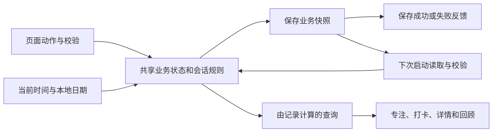

# 一刻逻辑与交互

本文规定业务对象、状态机、动作结果、数据流转、保存、恢复与统计口径。UI 的视觉顺序、滚动、图形和动效见 [UI 设计](ui-design.md)。

## 数据流转

页面动作先校验草稿与当前状态，由共享业务逻辑更新同一份事实，再尝试保存。视图变化与持久化成功是两个结果；保存失败时仍可能存在本次打开期间有效的内存变化。重试应保存同一结果，不再次创建实体、结算会话或增加统计。

| 事实源 | 写入路径 | 读取与派生 |
| --- | --- | --- |
| 当前会话、周期轮数 | 开始、暂停、继续、计圈、阶段完成、结束、放弃、切换、恢复 | 表盘、读数、动作可用性、恢复提示 |
| 专注历史 | 按会话身份幂等结算，跨日区间随记录保存 | 今日汇总、周月总计、每日图形、类型分布、日期明细 |
| 习惯与打卡 | 保存草稿、打卡、取消、撤销、归档、恢复、删除 | 列表进度、详情次数与热力图、回顾打卡事实 |
| 用户偏好 | 直接选择或面板确认 | 全应用外观、尚未开始的会话配置、后续记录决定 |
| 展示状态 | 导航、选日、翻期、滚动、弹层与草稿 | 维持本次打开连续性，不形成业务历史 |

## 首次使用与再次进入

### 首次使用

首次进入后显示专注页，选中番茄钟，第 1 轮待开始，没有正在进行的会话，也没有专注或打卡历史。

| 项目 | 初始值 |
| --- | --- |
| 表盘与外观 | 机械表盘，跟随系统 |
| 番茄配置 | 专注 25 分钟、短休 30 秒、长休 15 分钟，每 4 个完整轮次长休 |
| 常用倒计时 | 按顺序为 3、5、10、20 分钟 |
| 倒计时初始值与选择 | 首次进入选中常用 1，读数和量程为该项时长；常用 1 必填，其余可空 |
| 短时记录确认阈值 | 10 秒 |
| 提示音 | 开启 |
| 震动 | 开启 |
| 各模式反馈 | 独立提示音、触感、每秒滴答与间隔；默认值见反馈计划 |
| 初始习惯 | 喝够 8 杯水、读 20 页书、跑步、23 点前睡 |
| 习惯频率 | 跑步为每周 3 次，其余为每天 |
| 习惯提醒 | 全部关闭，提醒时间初始为 21:00 |

初始习惯可修改、归档或删除，只在首次初始化及确认重置后创建。用户删空习惯后，重新打开或跨到第二天都不会自动补回。

### 启动与重开

冷启动以已保存表盘呈现品牌静帧、名称和本机保存说明，随后进入专注，不增加人为等待、登录或确认步骤。首次使用为机械主题；减少动态效果时直接进入内容。

没有未结束会话时进入番茄钟待开始。有未结束会话时按保存的模式、阶段和进度恢复，具体规则见“离开、后台与中断恢复”。从后台返回、切换页面或返回设置不会重复显示启动页。

## 业务数据与本地保存

### 需要长期保存的数据

| 数据 | 保存的业务内容 | 用途与约束 |
| --- | --- | --- |
| 初始化信息 | 已完成首次初始化、首次使用日期 | 区分首次使用与用户主动删空数据；重置后重新初始化 |
| 用户偏好 | 表盘、浅色/深色/跟随系统、番茄配置、提示音、震动、倒计时每秒滴答、节拍间隔、短时记录确认阈值、四个常用倒计时及其顺序和空槽 | 重开保持设置；常用项按实际秒数保存，不向整分钟取整 |
| 习惯 | 独立身份、名称、图标、频率、每周目标、提醒开关和时间、创建日期、当前归档状态及归档日期、列表顺序 | 名称不是身份，允许同名习惯；修改名称不产生新习惯，也不丢失原记录 |
| 打卡记录 | 独立记录身份、所属习惯、打卡的本地日期、操作时间 | 同一习惯同一自然日最多一条有效记录；取消和撤销会改变对应事实 |
| 当前计时会话 | 独立会话身份、计时模式、专注/短休/长休阶段、状态、原始开始时间、固定目标时长、有效累计用时及按日期分配的用时、当前计圈、本轮休息类型、短记录确认结果 | 用于暂停继续、重开恢复、计圈及防止重复入账；结束会话后清除当前会话，不删除已经生成的记录 |
| 番茄周期进度 | 当前周期已完成的完整轮数 | 决定下一轮编号和休息安排；不能直接用历史记录数量推算 |
| 专注历史 | 独立记录身份、来源会话、模式、原始开始时间、实际有效总秒数、各本地日期分配的秒数 | 驱动今日汇总、回顾和类型分布；一次会话不能因重复操作生成多条记录 |

当前会话与历史记录是不同对象。运行或暂停中的会话不是已完成历史；到点可以同时存在一条已入账记录和一个等待用户处理的完成态会话。历史是否已经存在，必须按会话身份判断，不能仅按时间或显示文字判断。

习惯的归档日期用于表达当前归档状态。恢复后按进行中习惯展示，已有打卡记录仍保留；当前产品不提供独立的归档操作流水和历史目标版本查询。

### 保存时点与操作结果

| 操作 | 需要保存的结果 |
| --- | --- |
| 新建或编辑习惯并保存 | 习惯内容及原有身份关系；取消不保存草稿 |
| 打卡、取消打卡、有效撤销 | 对应习惯和日期的最终打卡事实 |
| 归档、恢复、删除 | 习惯状态；删除同时移除该习惯的打卡记录 |
| 选择表盘、外观或切换提示音 | 立即生效的偏好 |
| 滚轮稳定、选择配置、清空可选常用项或恢复默认 | 立即保存当前配置；关闭不回滚已经保存的值，尚未稳定或非法草稿不保存 |
| 开始、暂停、继续、计圈及阶段结束 | 当前会话和周期进度；符合记录规则时保存对应历史 |
| 完成、放弃、再计、跳过休息或结束并切换模式 | 结算后的历史、会话和轮次，不能丢弃已生成的记录或重复累计 |
| 确认重置 | 恢复首次使用数据和默认偏好 |

重新打开时，以已保存的业务数据恢复。异常中断恢复以最后保存的有效进度为准；页面内容已经变化与数据已经保存是两个结果，保存失败时需明确说明，不能把未保存的操作当作重开后一定保留的结果。

### 本次打开期间保留的状态

以下状态用于维持操作连续性，不作为专注历史或习惯事实长期保存：

- 当前根页面、未开始时选中的计时模式、番茄本次时长、倒计时本次值及选中常用项；已有会话的模式和目标时长则随会话保存。
- 回顾的周/月、锚点日期、最后浏览日期、明细开关，以及页面滚动位置。
- 未提交的表单和滚轮选择草稿、校验提示、确认面板和短提示。
- 最近一次打卡操作的撤销机会；撤销结束后只保留最终打卡事实。

计圈属于当前正计时会话，未结束会话恢复时保留；停止后只保存专注总时长，不将每一圈变成历史专注记录。表单取消后重开读取已保存内容，新建重开使用空白名称等默认值。

### 由记录计算的数据

今天已专注、每日专注量、周月总计、专注次数、专注天数、类型分布、今日打卡进度、习惯完成次数与热力图都由记录计算，不作为另一套独立事实手工累计。新增、撤销或删除记录后，相应页面重新反映同一份结果。

## 专注的共同规则

### 统一目标时长

专注与长休息、倒计时各入口为 1–3599 秒，分秒设置；短休息为 1–59 秒，只显示秒列，默认 30 秒。专注默认 25 分钟、长休默认 15 分钟。分为 0 时秒只能选 1–59；从 01:00 将分调成 0 自动变成 00:01。表盘按整秒提交，保留当前范围内合法的慢速 5 分钟卡位；倒计时选中常用项后以该项时长为上限。正计时从零累计到 59:59 自动结束并保留完成态 / 计圈；完成后的 00:00 是合法显示。

用户明确无需兼容旧数据，可自行卸载或重置；不自动清除旧数据。当前采用秒字段与快照版本 2，规则与手感参数见 [第二阶段](../plan/stage2-dial.md)。

### 同时只有一个会话

番茄、正计时和倒计时不能并行运行。运行、暂停、休息、完成或到点状态都先处理当前阶段，再进入另一模式。

暂停期间不累计用时；继续从已有有效用时接着计时。运行状态按实际经过时间推进，到点最多计至本阶段目标，不把超出的等待时间算入，也不自动开始下一个阶段。

打开设置、放弃确认、模式切换面板或重置确认，不因打开面板而自动暂停。明确点击暂停才暂停；从运行状态发起短时记录确认时，先冻结当前有效用时，避免确认过程中继续增长。

## 番茄钟流程

### 专注与休息

| 当前状态 | 操作或事件 | 后续状态与数据结果 |
| --- | --- | --- |
| 待开始 | 开始专注 | 创建独立会话，固定目标专注时长及本轮完成后对应的休息类型，从零计时 |
| 专注运行中 | 暂停 | 冻结有效用时，保留会话，不生成历史记录 |
| 专注暂停 | 继续 | 同一会话继续累计，暂停间隔不计入 |
| 专注暂停 | 结束并记录 | 按短时记录规则保存实际用时，回到当前轮待开始；不增加完整轮数，不进入休息 |
| 专注运行中或暂停 | 确认放弃本轮 | 清除当前未完成会话，不生成新记录；已完成的周期轮数保留 |
| 专注到达目标 | 本轮完成 | 增加一次完整轮数，显示完成态；按记录规则入账，不自动开始休息 |
| 本轮完成 | 开始休息 | 开始对应的短休或长休；休息时长在休息开始时确定 |
| 本轮完成或休息中 | 跳过休息 | 不生成休息记录，进入下一轮待开始；若本轮对应长休则结束本周期 |
| 休息运行中 | 暂停、继续 | 只改变休息状态，不改变专注历史 |
| 休息到达目标 | 休息完成 | 停在完成态，等待“准备下一轮”，不自动开始专注 |
| 休息完成 | 准备下一轮 | 短休后进入下一轮待开始；长休后回到第 1 轮待开始 |

完整轮数以“该轮专注是否达到目标”为准，与是否提前结束、历史记录有多少条不同。同一轮到点、刷新、重复点击均不能重复增加完整轮数。

默认每 4 个完整轮次安排长休。例如第 1–3 轮完成后是短休，第 4 轮完成后是长休；长休结束或被跳过后回到第 1 轮。提前结束或放弃当前轮不伪造已完成轮数，切换模式和跨日也不自动清空周期进度。

每轮专注开始时已确定该轮完成后的休息类型。专注途中修改长休间隔，不改变这一轮已确定的决定。休息真正开始时读取其时长；已经运行的休息不会因设置修改而跳变。

### 完整番茄与短时确认

短时记录确认不等于判断番茄是否完整。若将专注设为 1 分钟、记录确认阈值设为 3 分钟，专注到点仍是完整一轮，但保存这条短记录需要确认。

确认记录后保存有效用时；取消则保留本轮完成状态，不自动进入休息、不生成该条记录，完整轮数不回退。之后选择结束并进入休息时仍需处理这条未确认记录；跳过休息不补写未确认的短记录。

## 正计时与计圈流程

从零累计，最高 59:59；达到上限自动结束并按现有记录规则结算，保留完成态和计圈供查看，只发一次完成反馈，不允许继续累计。下列运行 / 暂停 / 手动结束规则继续适用。

| 当前状态 | 操作 | 后续状态与数据结果 |
| --- | --- | --- |
| 待开始 | 开始计时 | 创建独立正计时会话，从零累计 |
| 运行中 | 计圈 | 记下当前累计有效用时，结束上一圈并开始下一圈，不生成专注历史 |
| 运行中 | 暂停 | 冻结会话总用时和当前圈用时 |
| 暂停 | 继续 | 继续同一会话和当前圈，暂停间隔不计入 |
| 暂停 | 结束并记录 | 按短时记录规则保存一条总时长记录，结束当前会话 |
| 运行中或暂停 | 确认取消计时 | 放弃当前会话，不保存新的专注记录 |

计圈只在运行时可用，不能连续生成零用时的圈。当前圈在右侧记圈面板实时区显示；完整圈列表最新在前，使用圈次、单圈、累计三列。正计时主页面保留暂停/继续、结束并记录/取消，计圈入口为“计圈记录 · N 圈 ›”，仅在面板直接计圈；面板运行态可以计圈/暂停/结束并记录/取消，暂停态可继续/结束并记录/取消，取消仍需确认。关闭面板或打开取消确认不额外改变运行状态。

例如连续计时 2 分钟后计圈，再计时 3 分钟：第一圈为 2 分钟，当前圈为 3 分钟，累计为 5 分钟。中间暂停的时间不计入任何圈。停止后产生一条 5 分钟记录，而不是两条分圈记录。

圈统计只取已手动记下的完整圈，至少 2 圈才显示最快、平均、最慢，时长相同的圈全部标记。当前未记圈不入统计。59:59 自动完成保留面板/会话及计圈，最后一段标“末段 · 未计圈”，不能继续计圈或累计；点“完成”才清除会话。手动结束或确认取消会关闭面板；结束只保留一条专注总记录，圈明细不成为历史事实。

## 倒计时流程

### 选择与开始

常用项按四槽顺序与编辑图标同行，空槽不占位，没有自定义按钮。常用 1 必填，其余三项可空；每项 1–3599 秒，非空值不可重复。首次进入选中常用 1，本次值与量程为该项时长。

点击其它常用项，将本次值和上限设为该项时长，不立即计时；重复点击当前项保持读数与高亮。拨小目标后仍保持选中，不通过时长相等反推选中项。机械倒计时始终无数字盘，量程等于选中项；从调整到运行保持，实际目标和量程在开始时冻结并随会话保存。例如选 5 分钟后调至 2 分钟，从 40% 开始递减。修改常用项不改变正在进行的会话，“再计”仍沿用上一轮目标和量程。

编辑图标进入完整设置页，自动打开常用倒计时 FlowSheet；关闭弹层留在设置页，页面返回回专注。未改动保持原状态；改动后保留有效选中槽，读数高于新上限则缩到上限；选中槽被清空则回退常用 1。已开始会话不受影响。完整规则见 [第二阶段](../plan/stage2-dial.md)。

### 运行、完成与再计

| 当前状态 | 操作或事件 | 后续状态与数据结果 |
| --- | --- | --- |
| 待开始 | 开始 | 创建独立会话，从完整目标时长向零倒数 |
| 运行中 | 暂停 | 保留目标和有效用时，冻结剩余时间 |
| 暂停 | 继续 | 继续同一会话，不重置目标 |
| 暂停 | 结束并记录 | 记录已实际计过的有效时长；低于阈值先确认，不按目标时长入账 |
| 运行中或暂停 | 确认取消计时 | 清除当前未完成会话，不产生新记录，保留此前已经完成的记录 |
| 到达目标 | 到点 | 显示 00:00 和完成反馈，立即生成一条完整记录；不受短时确认阈值拦截 |
| 到点 | 完成 | 关闭当前结果，回到相同时长待开始；不再次生成记录 |
| 到点 | 按上次时长再计 | 保留旧记录，创建新身份的独立会话，以相同目标时长从零开始 |

再计显示上一轮的完整目标，例如“再计5分”“再计1分30秒”。它不读取当前常用项来替换上一轮时长，也不在原会话上追加时间。

例如 1 分 30 秒到点后等待 20 秒，再计一次并完整结束：回顾中是两条各 1 分 30 秒的记录，合计 3 分钟；等待的 20 秒不入账。新一轮提前取消只取消这一轮，第一条记录保持不变。

同一到点结果反复点击完成、切换页面、重开或重复请求，不重复生成旧记录，也不重复启动同一轮再计。

## 记录、模式切换与中断

### 短时记录确认

阈值只决定是否询问，不是最低可记录时长。默认 10 秒，可调整为预设或自定义秒数。

| 情况 | 是否记录与操作结果 |
| --- | --- |
| 有效用时为零 | 不生成零时长历史 |
| 主动结束，实际用时大于零且小于阈值 | 显示“仍然记录 / 暂不结束”；确认保存实际秒数，取消保留会话和有效进度 |
| 实际用时等于或超过阈值 | 正常结束并记录，不再二次询问 |
| 完整倒计时到点 | 直接记录，即使目标只有 1 秒、5 秒且低于阈值 |
| 完整番茄到点但低于阈值 | 保留完成态并询问是否保存；完整轮数与记录确认分别处理 |
| 明确放弃或取消计时 | 不生成当前会话的新记录；先前已经入账的独立记录保留 |
| 短休、长休 | 不生成专注记录，不因休息时长达到阈值而入账 |

从运行状态发起确认时先暂停；取消后停在原模式的暂停态，不自动继续。自然到点后取消记录确认则保持已完成状态，不把已到点的会话倒退成运行态。

### 切换计时模式

计时模式仅通过顶部 Tab 点击切换，不支持左右滑动。没有会话时直接切换。有未处理会话时保持原页面和选中项，先显示目标模式及处理后果，提供“结束”和“放弃”两个动作。关闭、点击遮罩或系统返回均取消此次切换；确认处理完成后才更新模式与页面。面板打开期间忽略重复请求。

- 运行或暂停的专注选择结束：结算实际用时，必要时进入短时确认；确认完成后进入新模式待开始。取消短时确认则留在旧模式的暂停态。
- 选择放弃：不新增当前未完成会话的记录，进入新模式；已经入账的记录不删除。
- 取消模式切换：保留原模式和会话。打开切换面板时若本来正在运行，取消后仍按实际时间运行。
- 休息中切换：离开当前休息，不记专注时长，轮次按跳过相应休息处理。
- 番茄完成态切换：保留已完成轮数和已保存记录，离开本轮并跳过待开始的休息；若应长休，按长休结束周期。
- 倒计时到点后切换：保留该轮已生成记录，清除完成态，进入新模式；不会自动再计。

### 离开、后台与中断恢复

| 情况 | 计时与返回结果 |
| --- | --- |
| 切换根页面、打开详情/编辑/设置 | 同一会话继续；返回专注时显示实际状态 |
| 应用仍在运行但进入后台 | 按实际经过时间继续累计；返回校准，不依赖后台动画持续播放 |
| 后台期间超过目标 | 只完成当前阶段，最多记录目标时长；超出部分不自动成为休息或下一轮 |
| 刷新、关闭或异常中断后重新进入 | 从最后保存的有效进度恢复；此前运行的会话转为暂停，不补算关闭期间时间 |
| 保存时本来已暂停 | 保持暂停，不把关闭期间算作用时，也不重复弹出首次恢复提示 |
| 已完成或已到点的会话重开 | 保持原结果，不重新计时、不重复入账 |

待恢复会话的面板显示已暂停及保存进度。专注可继续计时、结束并记录或放弃；休息可继续或跳过。关闭恢复面板只关闭面板，不删除会话，也不自动继续；暂停态仍可再次查看恢复选项。

继续恢复时，原会话身份、目标时长、计圈和日期分配保持连续。恢复以已经保存的进度为依据，未保存的最后一段不能被当作已经恢复或已经入账。

## 习惯与打卡流程

### 习惯字段与表单

| 字段 | 规则 |
| --- | --- |
| 名称 | 去除首尾空白，必须包含可见内容，最多 30 个可见字符；允许重名，不按名称合并记录 |
| 图标 | 从叶子、书、水、跑步、月亮、拉伸中选择；新建默认叶子 |
| 频率 | 每天或每周；每天以每天 1 次表达，每周目标为 1–7 次，新建草稿的周目标为 3 次 |
| 提醒 | 默认关闭；开启后显示本地时分，默认 21:00，00:00 为有效时间 |

新建从空名称、默认图标和每天开始。编辑读取该习惯已保存内容，切换频率或提醒不清空其它字段。提醒关闭时隐藏时间输入并保留已选时间，再次开启继续使用。

名称错误和时间错误在字段附近说明，修正后消失；未通过校验不能保存。保存处理中不能重复提交。同一次成功保存只创建一个习惯，不因重复点击生成多条。

新建保存后关闭面板，新习惯追加到打卡列表；编辑保存后回到原详情并更新名称、图标及目标。取消或关闭不修改原习惯，重开新建不沿用上一次取消的名称。面板覆盖原来源，键盘或可选内容出现后字段和保存操作仍可滚动到达。

### 今天打卡与撤销

打卡页按原有顺序展示进行中的习惯，标题、今日完成进度与新建入口在顶部。每行名称区域进入详情，今天的打卡按钮改变完成状态，七天标记只读、不提供补卡。

| 操作 | 数据与页面结果 |
| --- | --- |
| 点击未完成习惯的打卡按钮 | 为该习惯的今天建立有效记录；今天标记、今日完成数、本周进度、详情和回顾同步变化 |
| 再点已完成按钮 | 删除该习惯今天的有效记录，相关统计同步减少 |
| 点击撤销 | 反转最近一次对应习惯、对应日期的打卡变化；不会改动其它习惯或其它日期 |
| 新打卡操作覆盖旧提示 | 只保留最新一次操作的撤销机会 |
| 提示结束、离开打卡页、习惯被归档/删除或跨日后再撤销 | 旧撤销机会失效，不用撤销变相补卡 |

一次打卡即完成，不要求填数量或用时。同一习惯同一自然日最多一条有效记录；每周目标达到后，仍允许在其它日期继续打卡，实际完成次数可超过目标。

今日完成数只统计进行中习惯今天是否已打卡，分母为进行中的习惯数量。全部完成时显示安静的完成说明；没有进行中习惯时显示新建入口，存在已归档习惯时仍可查看与恢复。

### 详情与完成统计

详情以习惯名称为主要标题，显示本周完成次数/目标、本月次数、最近一年次数，以及截至今天最近 365 个自然日的热力图。

- 每日习惯：本周分母为本周内、从创建当天起（含当天）至今天的有效天数；当前处于归档状态时统计到归档前一天。
- 每周习惯：分母为当前每周目标，分子为本周实际打卡次数，不因超目标而截断实际记录。
- 本月按自然月，最近一年按最近 365 个自然日累计，而不是只统计当前年份。
- 创建前、未来日期、未打卡、已完成和当前归档期间分别表达，并都显示为实色格；已完成事实优先显示，不因归档覆盖已有打卡。
- 修改频率和目标后立即使用新目标展示当前进度，已有完成日期及次数不改写，不据新目标倒算历史达标率。

恢复习惯后按进行中状态计算当前目标和日期显示，原有完成记录保留，不为过去未打卡日期补记录。

### 编辑、归档、恢复与删除

| 操作 | 影响与返回 |
| --- | --- |
| 编辑保存 | 保持同一习惯身份，更新现有内容；历史记录不移动到新习惯，回到原详情 |
| 归档 | 立即从进行中列表隐藏，停止打卡入口，保留全部打卡事实；回到打卡页，可在已归档列表找到 |
| 恢复 | 回到进行中列表，保留原有身份、顺序和记录；不补过去的打卡 |
| 删除 | 先说明并确认；移除习惯及其全部打卡记录，相关打卡统计减少，专注历史不受影响；回到打卡页 |
| 取消删除 | 关闭确认，原习惯与记录保持原样 |

已删除或不存在的习惯不能继续编辑、归档或打卡。进入失效详情时说明对象不存在，并提供返回打卡的入口，不创建替代对象或虚构记录。

## 回顾与统计口径

### 日期与统计事实

使用设备本地日期，周一至周日为一周，月按自然月。打卡归属操作当日；跨午夜后“今天”变化，旧日期的撤销失效，未来日期不可打卡或查看明细。

| 统计项 | 计算规则 |
| --- | --- |
| 有效专注时长 | 只合计已入账记录的有效用时；暂停、关闭后的冻结、到点后等待和休息都不计入 |
| 专注次数 | 所选日期范围内有有效用时的独立会话数；一条跨日会话在覆盖两天的同一范围内只计一次 |
| 专注天数 | 范围内有有效专注时长的日期数；同一天多条记录仍是一天 |
| 打卡次数 | 范围内所有习惯有效打卡记录数，不等于打卡天数，也不等于习惯数量 |
| 类型分布 | 按番茄、正计时、倒计时分别合计范围内的有效时长与会话数；习惯不混入专注分钟 |
| 日期明细 | 使用记录原始开始时间和分配给所选日期的时长，不把跨日总时长重复显示为每天用时 |

实际用时按秒保存，跨日分配可保留不足 1 秒的部分。周期汇总先加总秒数，再换算分钟，不逐条舍入后累加。总计不足一分钟时仍显示实际秒数；整分钟以上的概览使用简洁分钟/小时表达，日期明细保留有效秒数。

例如两条各 35 秒记录应合计为 1 分钟以上，而不是分别向下取整后显示零。一次正计时在午夜前有 30 秒、午夜后有 60 秒：两天分别显示对应时长和一次会话；覆盖两天的周统计为 90 秒、一次专注、两个专注日。

专注的日期分配按发生时的本地日期保存，后续改变时区不重新移动历史归属。同一完成会话重复结算不增加次数，倒计时再计使用新会话身份，分别计数。

### 周月范围与空态

默认显示本周。周总计为专注时长、专注次数、打卡次数；月总计为专注时长、专注天数、打卡次数。

上一期可连续查看历史，不受首次使用日期或是否有记录限制；下一期最多回到本周/本月，不进入未来。历史范围可使用固定位置的入口返回当前周期，入口变化不推动正文。

切换周/月时，优先以最后浏览日期定位；没有浏览日期且在当前周期时以今天定位，否则以原周期锚点定位。切换后清除旧浏览日期和明细；前后翻期也清除旧浏览上下文。根页面往返保留本次打开期间的回顾范围及局部状态。

无专注也无打卡时保留范围导航和每日图形框架，显示简短零记录说明，不另设“去专注”按钮或长篇引导。仅有打卡时按日期显示实际打卡次数，不把整页当作没有数据。历史空周期可以继续翻阅，空日期可以打开，未来日期禁用。

### 图形与统计的对应

每日图形以真实专注记录计算；固定分档与三主题表达统一见 [每日图形](ui-design.md#每日图形与类型分布)。类型三行始终保留，基于本期全部类型展示。点击可筛选，再点取消；只影响专注统计、图形和日期明细，不影响打卡。筛选在翻期、周月切换及根页面返回时保留。汇总标题在原位置更新筛选类型，不插入额外标签或空态挤动图形。图形点击和长按均打开同一张 Menu 数据卡，卡内“查看当日记录”进入 Sheet，不保留日期选中边框或选中语义。卡内「专注」时长与次数同一行，打卡次数单独一行。按压反馈随三主题适配，今天标记和键盘焦点仍保留，不创建或编辑记录。

### 日期明细

点击或长按有效日期先查看同一张 Menu 数据卡；点击卡内“查看当日记录”，打开所选范围的日期面板，关闭后再次点击同日可重新打开。面板使用“每日记录”标题与关闭入口，先显示日期星期、专注合计和打卡次数，再按开始时间排列专注记录。记录使用开始、类型、时长三列，数字右对齐、文字基线对齐；当天完成的习惯逐条展示。

前一天和后一天固定在底部，逐日移动、不跳过空日，回顾来源不跨出打开时的周/月，统计年度图来源不跨出最近 365 天；都不进入未来。空日显示没有记录，不替换为最近有数据的日期。

长列表只滚动面板正文，关闭和翻日操作始终可达。切日不改变来源页面的布局、滚动或图形高度。关闭后只保留最后浏览日期作为范围切换的定位上下文，并恢复来源焦点，不形成日期选中态；再次点击该日重新打开明细。已有明细未关闭时不重复打开。切换周/月、前后翻期或返回当前周期时清除旧浏览上下文。

回顾只查看记录，不在此编辑专注历史、管理习惯或手动修改统计。习惯归档保留历史，恢复不补卡，删除会移除对应打卡历史；这些结果立即反映在当前范围。

### 独立统计与查看反馈

从回顾带当前周/月、锚点及类型筛选进入独立统计路由，统计内的选择与回顾分开，返回保留原回顾状态。

- 总专注、日均、专注天数、最长单次与趋势共用同一批已入账日期分片。最长单次按会话身份汇总本期分片，标“本期内”；不直接拿原会话总长，也不把分片当成独立会话。
- 日均分母为已结束周期天数，当前周期截至今天（含今天）。当前周期比较上一期相同已过自然日；上月不足对应日期时截到其月末，按各自实际天数算日均，并显示比较范围。历史周期比上一完整周期。概览先合秒再换单位，足一分钟用简洁时/分，明细保留秒数。
- 趋势为 8 周/6 月，默认截至本期；选中超出窗口时，以该期为窗口末端，窗口内点柱不移动窗口。类型环始终显示本期全部类型，环/图例点击与顶部筛选同步；其它专注图形随筛选。
- 24 小时分布将范围内的分片用时归到原会话开始小时，说明“按开始时间”。不按分片日期的午夜重置小时，也不带入范围外时长。
- 习惯只列当前进行中项，不受类型筛选影响；完成格点击/长按均打开与习惯详情相同的 Menu 数据卡。每日习惯分母为本期从创建日起至今天的有效天数；周习惯周视图用当前周目标，月视图仅显示完成次数及当前每周目标，不虚构月分母。历史标“按当前规则”，不据当前频率还原不存在的历史目标版本。
- 年度区标题为“最近一年专注”，范围始终为截至今天最近 365 天，与周期独立、随类型筛选。按 0、≤30 分钟、≤90 分钟、>90 分钟四档，点击和长按均查看同一张 Menu 数据卡，卡内入口进入每日记录 Sheet。
- 回顾/统计查看卡的选择触感只受触感总开关和前台状态控制；习惯卡还受打卡触感开关控制。只读卡不发声音、不改记录，一次操作仅一次触感。没有新增反馈配置或持久化字段。

## 设置流程

### 配置与范围

| 项目 | 默认值与范围 | 应用时点 |
| --- | --- | --- |
| 表盘 | 机械、水位、日影，默认机械 | 选择后立即改变全应用主题和图形，不改变业务数据 |
| 外观 | 浅色、深色、跟随系统，默认跟随系统 | 立即生效；跟随系统响应系统变化，与表盘独立 |
| 番茄专注 | 默认 25 分钟，范围 1–3599 秒，分秒 | 稳定后保存，用于下一次专注并清除本次覆盖 |
| 短休、长休 | 短休默认 30 秒、1–59 秒；长休默认 15 分钟、1–3599 秒 | 稳定后保存，用于尚未开始的休息 |
| 长休间隔 | 默认 4 轮，范围 2–8 轮 | 用于随后新开始专注时的休息类型决定，不回改当前轮 |
| 常用倒计时 | 四个有顺序的槽位，默认 3、5、10、20 分钟，常用 1 必填，其余可空；非空值 1–3599 秒 | 单项保存、清空或恢复默认即生效，不改变已运行会话 |
| 短时记录阈值 | 默认 10 秒；预设 5秒、10秒、1分钟、3分钟、5分钟、10分钟，或自定义 1–86399 秒 | 确认后用于后续记录决定，不改变计时目标或有效用时 |
| 提示音 | 默认开启 | 切换即保存，声音总开关；与局部提示音共同控制声音，不改变计时和记录 |

表盘选择用三张真实缩略预览呈现，所有页面立即采用同一主题。设置打开和返回不打断计时，运行中的数字不能因设置变动跳到新时长。

普通时长、间隔和记录阈值打开选择面板，滚轮稳定后自动保存，返回或关闭不回滚已保存值。自定义记录阈值以秒保存，15 秒等值在关闭后重开、重新进入应用后仍是原值，不向分钟取整。错误就近说明，非法范围不保存。

### 常用倒计时

先展示四个槽位，点击某项进入分秒选择。滚轮稳定后校验并自动保存，仍留在编辑步骤；重复值不保存，保留草稿和错误说明。常用 1 不可清空；其余项清空后立即保存并返回列表，专注页不展示空槽。恢复默认立即恢复四项。步骤返回与关闭不回滚已保存改动，不自动提交非法或未稳定草稿；关闭弹层留在设置页。

FlowSheet 指示器可选，默认关闭且不预留空位；只有线性流程明确配置时，才在内容下方、操作区上方固定显示。保留必要校验反馈，不重复显示“四项、可修改、留空不显示”等说明。专注页常用项与编辑图标同行，移除自定义按钮；窄屏允许正文滚动，编辑入口和开始操作始终可达。

### 重置数据

先说明将清除当前会话、专注历史、所有习惯及打卡、周期轮数和偏好，并恢复默认配置及四个初始习惯。

取消关闭确认并保留全部内容；运行会话不因打开重置确认而暂停。确认后清除所有旧事实和临时状态，回到机械主题、跟随系统、番茄第 1 轮待开始，不保留旧计圈、历史、回顾选择、撤销提示或未提交草稿。

重置是重新初始化，不是只清空统计，也不是永久移除初始习惯。普通习惯删除不会触发全局重置。

## 跨页面联动、错误与反馈

| 变化 | 应立即反映的内容 |
| --- | --- |
| 专注记录入账 | 专注页今日汇总、回顾周期总计、对应日期图形、类型分布及日期明细 |
| 打卡、取消或撤销 | 今日完成进度、习惯本周标记、详情次数与热力图、回顾打卡数及日期明细 |
| 修改习惯名称或图标 | 列表、详情、已归档列表及回顾中的该习惯展示，原有记录关系保持 |
| 归档与恢复 | 进行中/已归档列表和今日进度；历史打卡事实不增加或减少 |
| 删除习惯 | 列表与详情不可再访问，打卡历史和相关统计减少；专注统计不变 |
| 切换主题或外观 | 所有页面与面板同步，当前会话、记录和表单内容不变 |
| 设备本地日期跨日 | 今天指向新日期，打卡入口和当前周期重新计算；不自动结束或重置正在进行的会话 |

空态说明为什么为空，并给出符合页面职责的下一步。校验错误贴近字段；取消不污染原值。放弃、删除、重置先说明后果再确认，打卡使用可撤销反馈，归档不删除数据。

保存失败时保留当前操作和本次打开中的内容，提示尚未保存及关闭后可能丢失，并提供重试；重试不重复创建习惯、打卡或专注记录。数据无法读取时明确提示，不自动用虚构历史替换，也不在用户确认前覆盖旧数据；恢复默认需确认重置。

提醒开关和时间会保存并展示在习惯信息中；当前范围不实际发送通知。完成提示在计时阶段完成时出现，提示音开启与否不影响是否保存记录。页面内容变化是操作结果，短提示只作补充，不替代完成态或保存失败说明。

## 保存触发与恢复限制

首次初始化、恢复状态规范化及业务结果变化需要保存；各操作的保存内容见 [保存时点与操作结果](#保存时点与操作结果)。记录结算与会话清理必须保持一致，避免恢复后丢失记录或重复入账。

“运行中已经显示 N 秒”不等于“N 秒已保存”。异常关闭可能丢失从最后保存点到关闭前的整段进度，而不只是最后一秒。重开按最后有效保存点恢复，运行态转为暂停，不补算关闭期间时间。本轮维持现有保存与恢复规则；如需提高保存频率或改变关闭后补时，另作产品决定，边界见 [已知缺口](../known-gaps.md)。

读取失败或数据损坏时保留旧数据并提示；不得以演示数据替换，也不能先覆盖后询问。写入失败应展示未保存状态和重试，不能提前关闭正在提交的编辑并宣称成功。当前实现与验证状态见 [已知缺口](../known-gaps.md)。

## 声音与震动（第一阶段）

事件矩阵及主题音色见 [反馈计划](../plan/stage1-feedback.md)。开始、暂停、继续和计圈为轻震；新的有效打卡为主题短音与中震，取消打卡或撤销为选择震动。有效动作被内存接受后反馈，不等待保存成功；无效动作、保存重试、历史读取不反馈。普通按钮、切换模式、Tab 和弹层开关不增加反馈。

每种计时模式独立设置提示音、触感、每秒滴答及间隔，打卡独立设置提示音与触感；声音和触感另有总开关。有效值为总开关与局部开关共同开启，关闭总开关保留局部选择。番茄 / 正计时每秒滴答默认关闭、间隔默认 5 分钟；倒计时每秒滴答默认开启、间隔默认关闭。番茄休息不新增节拍。

每秒滴答和间隔同秒时仅间隔反馈；到零仅完成音与间隔 120ms 的双强触。倒计时剩余 10–1 秒轻触不受滴答开关影响，但仍遵循触感两级开关。事件读取其会话模式的配置，前台其它 Tab 同样生效，暂停或后台停止，恢复不补播。保存失败不重做操作，系统触觉关闭时不绕过系统设置。设置立即保存、不改会话目标或记录；当前版本不兼容旧格式。完整矩阵见 [反馈计划](../plan/stage1-feedback.md)。

## 表盘拨动与反馈

三主题拨过整秒为已有 tick＋选择触感，拨过整分钟仅已有 chime＋轻震；按数值经过触发，停手不持续播放，快速拨动至少 40ms 间隔且不补播。只受本模式提示音 / 触感、对应总开关及系统允许控制，不受运行中的每秒滴答或节拍间隔控制。取消原额外轻音量和水位变调。

仅番茄 / 倒计时待开始可调，正计时、运行、暂停、休息和完成只读。轻触不改值，4px 后形成有效移动，松手惯性 / 吸附到合法整秒；切换模式、常用项、页面或进入后台前提交当前值。后台停止反馈，返回不恢复惯性。番茄本次覆盖不改变默认值，开始消费；模式往返保留，修改默认专注时长清除。读屏每次增减 1 秒；业务校验拒绝过期模式、起始值或上限。

设置“记录与反馈”提供单一“试听提示音”入口，仅播放当前主题完成音、不震动；声音总开关关闭时置灰，系统静音规则不变。试听不受某模式的局部声音开关影响，局部声音开启时原有短音试听保留。
